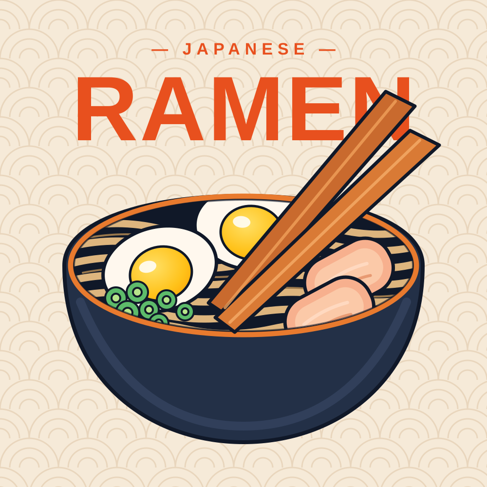

# Ramen SVG

Hand-drawn, flat-style ramen illustrations as lightweight, editable SVG files.
No image tracing was used — each file is written by hand with SVG paths,
ellipses, gradients, and patterns.

## Files

- `ramen-bowl.svg` — top-down ramen bowl: blue bowl, broth, noodles, two
  halved eggs, nori, green onions, chopsticks, and sparkles. Bright colour version.
- `ramen-poster.svg` — Japanese ramen poster style: cream seigaiha wave
  background, "JAPANESE RAMEN" title, dark bowl with an orange rim, noodles,
  two halved eggs, chashu pork slices, green onions, and diagonal chopsticks.

## Use

Open either `.svg` in a browser or vector editor, or embed it in a web page:

```html

```

Because the artwork is vector, it scales without losing quality, and colours
can be edited by changing the `fill` and `stroke` values in the file.
